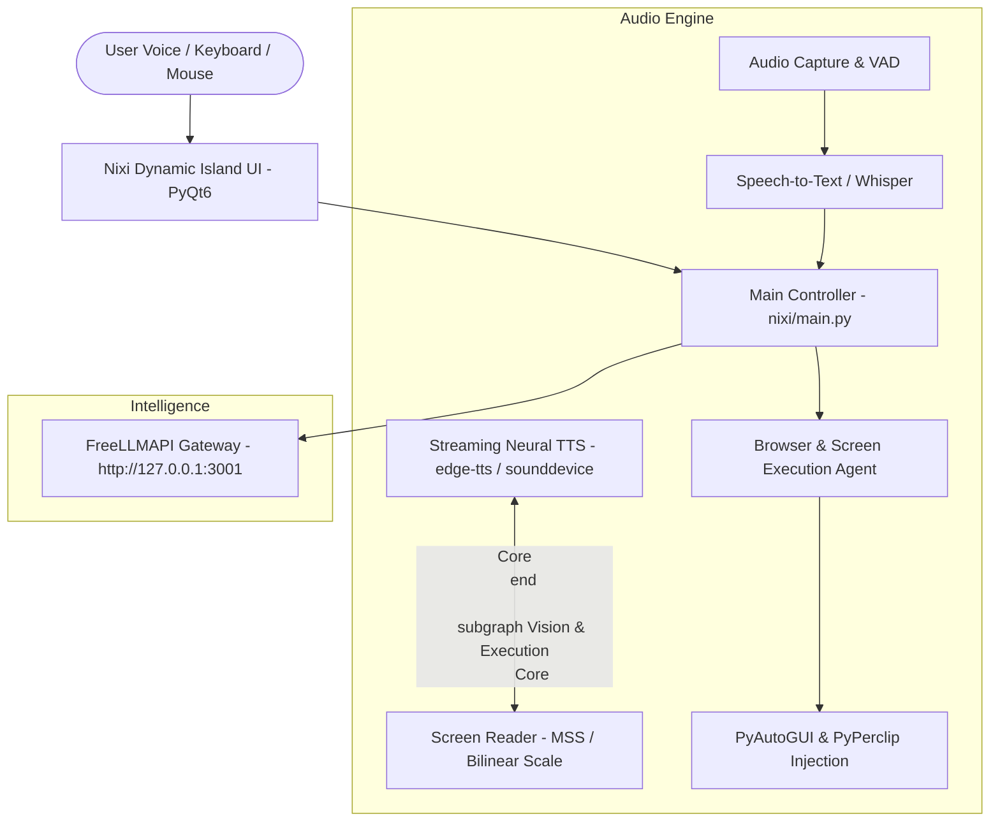

# Nixi AI Desktop Assistant ✦

A Windows-first desktop AI assistant inspired by **HeyNixi** and Apple's **Dynamic Island**. Nixi combines voice/chat, a compact PyQt UI, allow-listed native Windows actions, bounded file skills, task progress/cancellation, and optional integrations with a controlled browser, Office document files, and VS Code. Supported system actions do not invoke a shell.

---

## ✨ Features

- **🏝️ Dynamic Island UI**: Lives at the top-center of your screen as a 156×42 capsule with multi-emotion animated eyes (`happy`, `listening`, `thinking`, `speaking`, `surprised`, `winking`) and a live **5-bar reactive audio wave visualizer**. Expands smoothly on hover to a 510×295 glassmorphic control drawer with text prompt input, mic tool, and god-mode action chips.
- **⚡ Streaming voice responses**: Displays assistant text in one updating chat turn while sentence-based speech plays. Push-to-talk supports interruption while Nixi is speaking; recognition/model latency still depends on the configured device and provider.
- **🗣️ Voice input/output**: Uses the configured speech recognizer and TTS provider. Hindi/Hinglish-friendly multilingual recognition, push-to-talk, barge-in, and spoken cancellation are supported where the configured audio devices and providers are available.
- **👑 Bounded Native Controls**:
  - **Volume & Media**: Control master volume (`volume 70`, `mute`, `unmute`), media playback (`play`, `pause`, `next track`, `skip`).
  - **Window Management**: `tile left`, `tile right`, `maximize`, `minimize all`, `show desktop`, `lock computer`.
  - **Hardware Diagnostics**: Instant CPU, RAM, Disk, and Battery diagnostics (`system status`).
  - **Web tools**: Search and page-reading features depend on configured providers and available network access; Nixi reports when a provider is unavailable.
  - **Native Windows actions**: Change volume/media state, open allow-listed Settings pages and apps, manage common windows, and inspect system status without invoking PowerShell, CMD, or another shell.
  - **Bounded file skills**: Find files and create/move/rename/trash files under the home folder; overwrites are refused, trash/moves are undoable, and destructive actions require confirmation.
- **🎯 Bounded app integrations**: Playwright can target visible browser controls by name and verify filled values. Screen-coordinate interactions require confirmation; if visual targeting is uncertain, Nixi does nothing rather than inventing data. Office skills create/read Word and Excel files, and VS Code skills open files/projects; unsupported arbitrary automation is not promised.
- **🎙️ Direct-to-App Dictation**: Transcribes your speech in real time and automatically types it into whatever window is currently focused.
- **👁️ Screen Vision**: Can analyze the visible screen for an explicit visual request when the configured vision provider and screen-capture dependencies are available.
- **🧠 Configurable model providers**: Uses Nixi's configured provider/model settings; network availability, rate limits, and provider costs vary.
- **⌨️ Global Windows Hotkeys**:
  - `F8`: Toggle instant dictation on/off.
  - `F9`: Expand/collapse the Dynamic Island drawer.
  - `F10`: Analyze active screen content with Vision AI.

---

## 🛠️ System Architecture



---

## 🚀 Quick Start

### 1. Prerequisites
- **Windows 10 / 11**
- **Python 3.10+** (ensure `python` is added to your system `PATH`)
- **Node.js 18+** (for the local FreeLLMAPI gateway)

### 2. Installation
Clone the repository:
```bash
git clone https://github.com/Naserkhan07/AI-assistant.git
cd AI-assistant
```

Run the automated setup script in PowerShell:
```powershell
.\setup.ps1
```
This script creates a virtual environment, installs Python dependencies, configures `.env`, and runs capability diagnostics. To also download the separate Chromium runtime for controlled DOM-based browser actions, use `.\setup.ps1 -InstallBrowser` (the download is optional and sizable).

### 3. Launching Nixi
Start the assistant anytime with:
```powershell
.\start.ps1
```
The floating Dynamic Island capsule will appear at the top-center of your screen.

---

## ⚙️ Configuration (`.env`)

Copy `.env.example` to `.env`:
```env
FREELLMAPI_URL=http://127.0.0.1:3001/v1
FREELLMAPI_KEY=your-freellmapi-key
FREELLMAPI_MODEL=auto:fast

ASSISTANT_NAME=Nixi
USER_NAME=Sir

TTS_ENGINE=edge-tts
TTS_VOICE=en-US-AvaNeural
STT_ENGINE=google
```

---

## ⌨️ Shortcuts & Commands

| Trigger / Shortcut | Action |
|---|---|
| **Hover on Capsule** | Expands the Dynamic Island drawer |
| **`F8`** | Toggle dictation mode (types voice directly into focused window) |
| **`F9`** | Expand / Collapse the drawer |
| **`F10`** | Quick screen vision analysis |
| *"Fill these boxes"* | Auto-detects and populates active form fields (ID, Name, Description) |
| *"Open [app]"* | Launches any Windows desktop application (e.g. `open chrome`, `open notepad`) |
| *"Set timer for 5 minutes"* | Runs countdown timer with auditory chime alert |

---

## 📄 License
MIT License. See [LICENSE](LICENSE) for details.

## Responsive system actions
- Voice transcription runs off the audio callback; the Whisper model warms in the background so startup stays responsive.
- Commands get an immediate visual acknowledgement, duplicate recognitions are debounced, and long-running work shows a live "still working" status instead of appearing frozen.
- Model requests use shorter bounded timeouts and a single fast primary attempt; a stalled stream preserves partial output and reports the stall.
- Arbitrary PowerShell/CMD/shell execution is disabled; Nixi uses Python and native Windows APIs/libraries for supported actions, and shell-launch shortcuts are blocked.
- For clear natural-language action requests, Nixi can select built-in app, system-status, file-search/create/move/rename/trash, settings, volume/media, window, note, and folder-organization skills. High-impact changes require confirmation, and supported file actions are undoable. This is capability-bounded rather than unrestricted arbitrary control.

## v2.1 — voice i18n, theming, vault, automation
- Voice: Hinglish/Hindi STT language param, TTS profiles (en_neutral/hi_female/hinglish), VoiceGate (open/wake/ptt/muted), partial transcript hook
- i18n: en/hi/hinglish catalog (`nixi/i18n`)
- Vault: encrypted form-fill (`nixi/security/vault.py`)
- Integrations: bounded Playwright DOM actions (when Chromium is installed), Word/Excel document skills via Python libraries, and shell-free VS Code project opening. Screen-coordinate actions require confirmation and never guess data when visual targeting fails.
- UI: themes (dark/light/high-contrast), markdown+citations renderer, NotificationCenter, Timeline
- Packaging: `packaging/build.ps1` + docs/ARCHITECTURE.md
